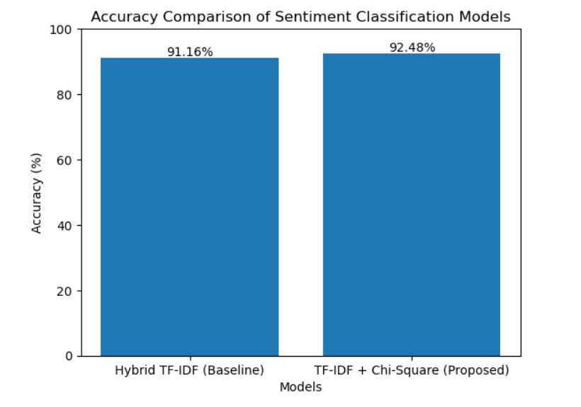
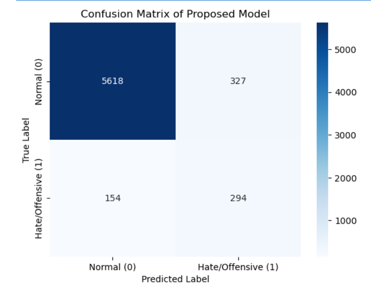

# Hate and Offensive Speech Classification Using Machine Learning

An NLP-based machine learning project for classifying Twitter text into **Normal** and **Hate/Offensive** categories.

The project compares a baseline **TF-IDF + Logistic Regression** model with a proposed **TF-IDF + Chi-Square Feature Selection + Linear SVM** approach.

## Project Overview

The objective of this project is to identify hate and offensive content from textual social media data using machine learning and natural language processing techniques.

The project evaluates whether Chi-Square feature selection combined with Linear SVM can improve classification performance while reducing the TF-IDF feature space.

## Methodology

The machine learning pipeline consists of:

1. Text cleaning
2. Stopword removal
3. WordNet lemmatization
4. Stratified train-test split
5. TF-IDF feature extraction
6. Chi-Square feature selection
7. Machine learning classification
8. Performance evaluation
9. Stratified 5-fold cross-validation

## Models

### Baseline Model
- TF-IDF feature extraction
- Logistic Regression
- Balanced class weights

### Proposed Model
- TF-IDF feature extraction
- Chi-Square feature selection
- Linear SVM (LinearSVC)
- Balanced class weights

## Feature Selection

The initial TF-IDF representation contained **16,972 features**.

Chi-Square feature selection was applied to retain the **5,000 most relevant features** for the proposed model.

## Results

| Model | Test Accuracy |
|---|---:|
| TF-IDF + Logistic Regression | 91.16% |
| TF-IDF + Chi-Square + Linear SVM | **92.48%** |

The proposed approach improved test accuracy while reducing the feature space from **16,972 to 5,000 features**.

### Accuracy Comparison



### Confusion Matrix



## Cross-Validation

Stratified 5-fold cross-validation was used to evaluate model stability.

| Model | Mean CV Accuracy | Mean Weighted F1 |
|---|---:|---:|
| Baseline | 91.88% | 92.60% |
| Proposed | **93.08%** | **93.75%** |

## Evaluation Metrics

The models were evaluated using:

- Accuracy
- Precision
- Recall
- F1-score
- Classification report
- Confusion matrix
- Stratified 5-fold cross-validation

## Technologies Used

- Python
- Pandas
- NLTK
- scikit-learn
- TF-IDF
- Logistic Regression
- Linear SVM
- Chi-Square Feature Selection
- Matplotlib
- Seaborn
- Jupyter Notebook

## Repository Structure

```text
hate-offensive-speech-classification/
├── sentiment_analysis.ipynb
├── README.md
├── requirements.txt
├── .gitignore
└── results/
    ├── accuracy_comparison.png
    ├── confusion_matrix.png
    └── README.md
```

## Running the Project

Clone the repository:

```bash
git clone <YOUR-REPOSITORY-URL>
cd hate-offensive-speech-classification
```

Install the required dependencies:

```bash
pip install -r requirements.txt
```

Start Jupyter Notebook:

```bash
jupyter notebook
```

Open `sentiment_analysis.ipynb` and execute the cells in sequence.

> The notebook expects the dataset file used for the experiment to be available locally as `twitter.csv`.

## Future Work

Future improvements can include:

- Improving minority-class precision and recall
- Exploring additional class-imbalance handling techniques
- Comparing additional machine learning classifiers
- Evaluating transformer-based NLP architectures
- Extending the system to multiclass hate-speech classification

## Author

**D. V. S. N. Sai Tejaswini**

B.Tech Information Technology  
PVP Siddhartha Institute of Technology
